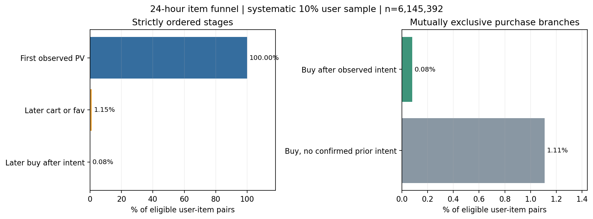
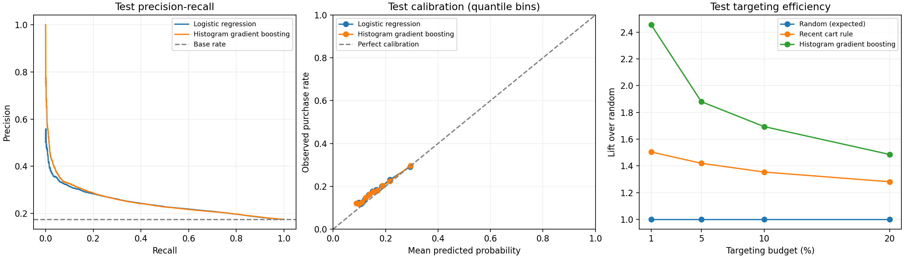

# 淘宝用户行为分析：转化诊断、购买倾向预测与运营决策

基于公开淘宝用户行为日志，研究电商用户的真实转化路径、历史行为与未来购买的关联，并评估有限触达预算下的用户筛选策略。项目聚焦 **指标口径、统计推断、时间外验证、运营决策** 四个环节。

**数据与工具：** 2017-11-25 至 2017-12-03（北京时间），约 1 亿条 PV、加购、收藏、购买事件；DuckDB、SQL、Python、Pandas、SciPy、scikit-learn、Matplotlib。

## 核心结果

| 分析环节 | 结果与业务解释 |
|---|---|
| 数据质量 | 原始 100,150,807 条事件；剔除窗口外 55,576 条后，保留 **100,095,231** 条、987,991 名活跃用户。按日期与行为类型逐组核对原始数据和已有数据库，无数量差异。 |
| 转化诊断 | 全量 Buy/PV 事件比为 2.25%，9 天内购买用户占活跃用户 68.06%，二者含义不同。在 98,767 名系统抽样用户的 **6,145,392 个合格用户—商品对** 中，首次观察 PV 后 24 小时内有购买的比例为 1.19%；加购或收藏后再购买占全部合格对的 0.081%，占已观察到中间意向对的 7.05%。 |
| 用户画像 | 历史 4 天活跃且有购买行为的用户，次日购买率 21.80%；有加购、无历史购买用户 16.06%；仅收藏意向 12.08%；仅浏览 11.70%。按历史行为定义互斥客群，无需人为指定价值评分。 |
| 统计推断 | 测试日 197,397 名合格用户中，历史有加购组未来 1 日购买率为 19.29%，无加购组为 14.93%，粗率差 **4.36 pp**（95% CI 4.03–4.70 pp，双侧 p < 0.001）。按历史活跃天数与购买记录标准化后，率差为 **3.48 pp**（95% 近似 CI 3.13–3.83 pp）；仍为关联。 |
| 预测模型 | 构造 967,424 个用户—日期快照，按时间顺序训练、验证和测试。梯度提升树的验证 AP 高于逻辑回归，因此作为策略模型；时间外测试 AP **0.2477**（正类基准率 0.1752），ROC-AUC 0.5994。 |
| 运营策略 | 相同 Top 10% 预算（19,740 名用户）下，模型命中 **5,857** 名实际未来购买用户，命中率 29.67%，相对随机期望 1.69 倍、相对近期加购规则提高 **5.96 pp**（多覆盖 1,176 名自然购买者）。结果是离线购买命中，而非实际营销增量。 |

### 时间外模型比较

| 方法 | 验证 AP | 测试 AP | 测试 ROC-AUC | 测试 Brier ↓ |
|---|---:|---:|---:|---:|
| 逻辑回归 | 0.2366 | 0.2429 | 0.5994 | 0.14194 |
| Histogram Gradient Boosting | **0.2415** | **0.2477** | 0.5994 | **0.14174** |





## 方法与口径

1. **数据工程。** 从 `UserBehavior.csv` 按明确 schema 流式读入，固定北京时间、九天观察窗；验证合法性并与 DuckDB 清洗表核对。没有事件 ID，不假定同秒事件必然重复。原始 CSV 与既有数据库均保持只读。数据量较大，使用 SQL 聚合和 Parquet 中间产物，避免一次性载入原始日志。
2. **描述性分析。** 全量计算活跃用户、购买用户、事件量等日/小时指标。独立用户不能跨时间简单相加。严格漏斗固定抽取 `user_id % 10 = 0`，以同用户同商品的首次观察 PV 为锚点，只判断 24 小时内严格先后次序；排除最后一天首次发生 PV 的右截断样本。加购与收藏可重叠；未观察到有序中间意向不代表真实直接购买。
3. **统计推断。** 单一测试日、每用户一次；Pearson 双侧检验、Wilson 比例区间和 Newcombe–Wilson 率差区间。按前 4 天活跃天数和历史购买分层标准化，所有六层均具有共同支持。**不使用 PSM 强行解释因果**：缺乏真实干预及分配日志，潜在需求、价格、曝光等变量缺失，匹配或标准化都不能保障无未观测混杂。
4. **时间外预测。** 固定抽取 `user_id % 5 = 0`，每次评分使用前四天（d−4 至 d−1）的 11 项行为特征，标签为评分日 d 是否产生任何购买。补齐无活动日期，保留未购买用户；同一用户可能跨日期出现，但用户 ID 不作为特征。训练日 11/29–12/01、验证日 12/02、测试日 12/03；以验证 AP 选择模型，测试仅作最终评估。AP 是 average precision，而非梯形积分 PR-AUC。
5. **决策闭环。** 比较随机期望、近期加购排序、LR 和提升树排序，在 1%/5%/10%/20% 相同预算下计算 Precision、Recall、Lift；使用验证集特征置换解释模型。真实上线时先固定目标人群，再用户级 1:1 随机分配推送/对照，按 ITT 比较 24 小时购买率并监控退订、投诉。`ab_sample_size_plan.csv` 是基于历史 Top 10% 人群、假设 MDE 的样本量规划，不是已经运行的 A/B 实验。

## 复现与审阅

在项目根目录运行：

```bash
pip install -r requirements.txt
python run_analysis.py
python -m unittest discover -s tests -v
```

已有 DuckDB 则以只读模式复用并核对；只有原始 CSV 时在 `outputs/cache/` 中重建清洗数据库。默认 DuckDB 内存限制 600 MB、2 线程，可用 `--memory 1GB --threads 4` 调整（注意机器可用内存）；支持 `--stage data|funnel|inference|model` 逐阶段运行。`inference` 和 `model` 使用 `data` 阶段产生的快照缓存，因此更换数据后务必先重跑 `data`。

审阅入口：**[analysis_v2.ipynb](analysis_v2.ipynb)**，已包含实际运行输出；默认读取结果，设置 `RECOMPUTE=True` 可从头计算。关键文件：

| 文件 | 用途 |
|---|---|
| `run_analysis.py` | 一键或分阶段复现实验 |
| `src/data.py` | 数据核对、时序特征、客群分层 |
| `src/funnel.py` | 全量指标与固定窗有序漏斗 |
| `src/inference.py` | 购买关联检验、区间、分层标准化 |
| `src/modeling.py` | 模型训练/验证/测试、特征解释与触达策略 |
| `src/experiment.py` | 前瞻 A/B 样本量规划 |
| `outputs/` | 实际结果 CSV、JSON 与图表；`cache/` 为中间数据，不入 Git |
| `tests/test_core.py` | 标签时间泄漏、漏斗次序/边界、统计及排序策略测试 |
| `legacy/` | 重构前的 Notebook、结果表及旧漏斗图，仅供历史对照 |

原始 `UserBehavior.csv` 和 `taobao_project.db` 保留在项目根目录；历史分析成果统一归档至 `legacy/`，不作为本版本结果。

## 结论边界

该数据只有 9 天，缺少价格、曝光渠道、真实干预和营销成本。用户 ID 取模是可复验的系统抽样，不保证随机代表性。模型排序能力有限（AUC 约 0.60），只通过一个后续测试日检验，不可直接推广到长期商情。策略的主要价值是有限预算下的自然购买命中效率；不能据此宣称真实订单数、GMV 或营销 ROI 获得提升。后续真正的增量响应应通过随机试验估计。


